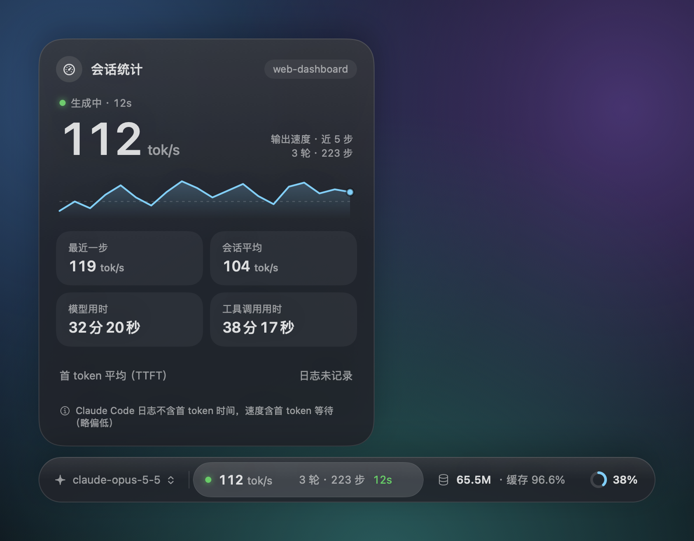
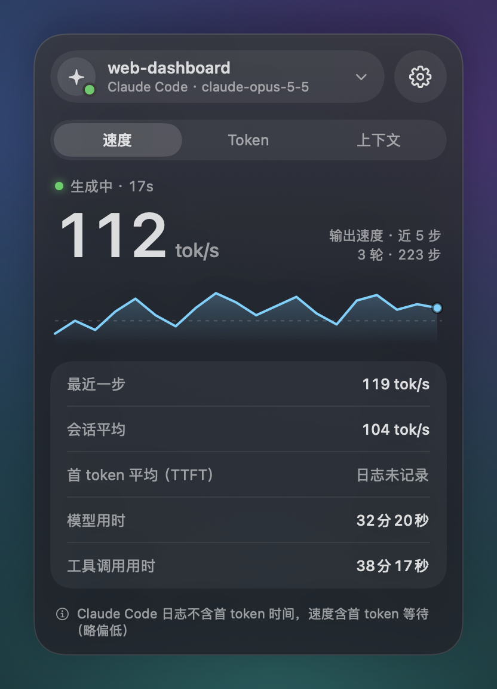
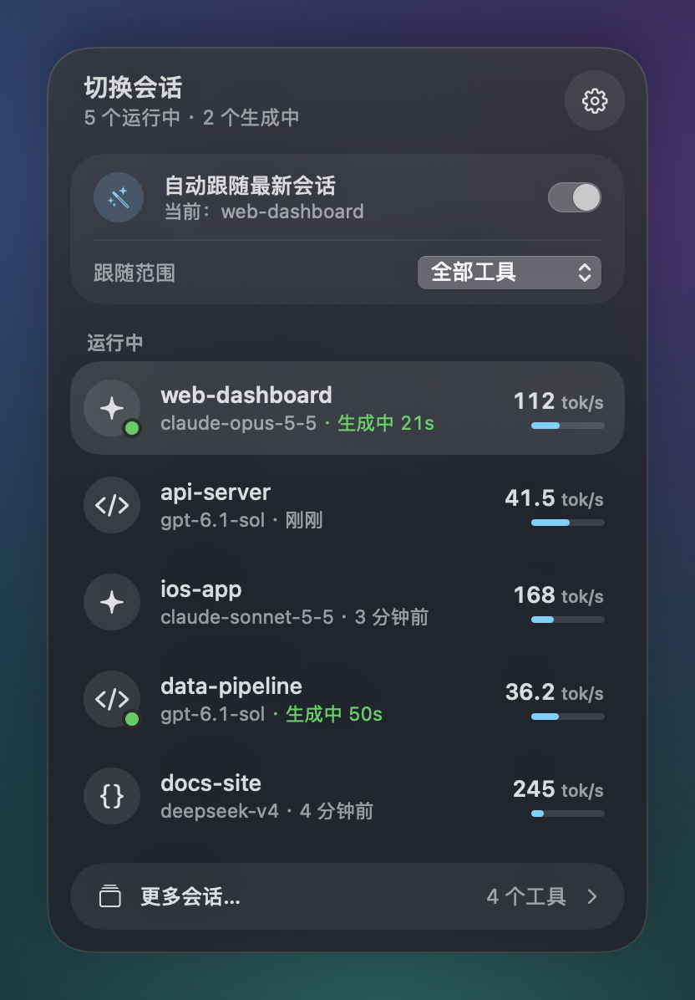
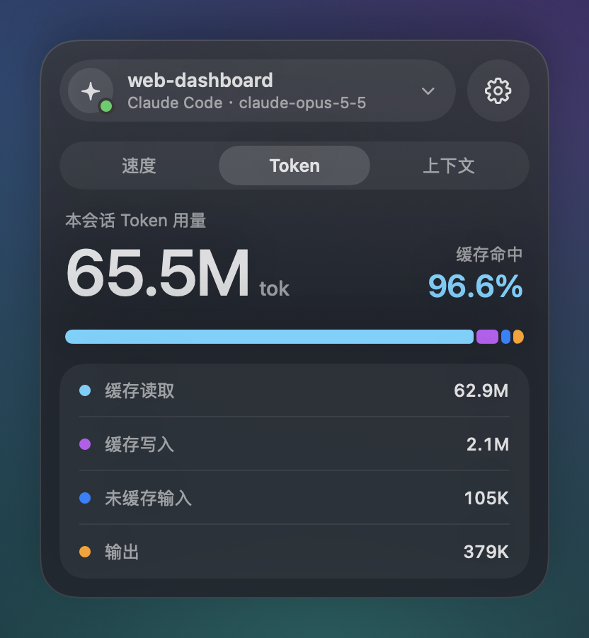
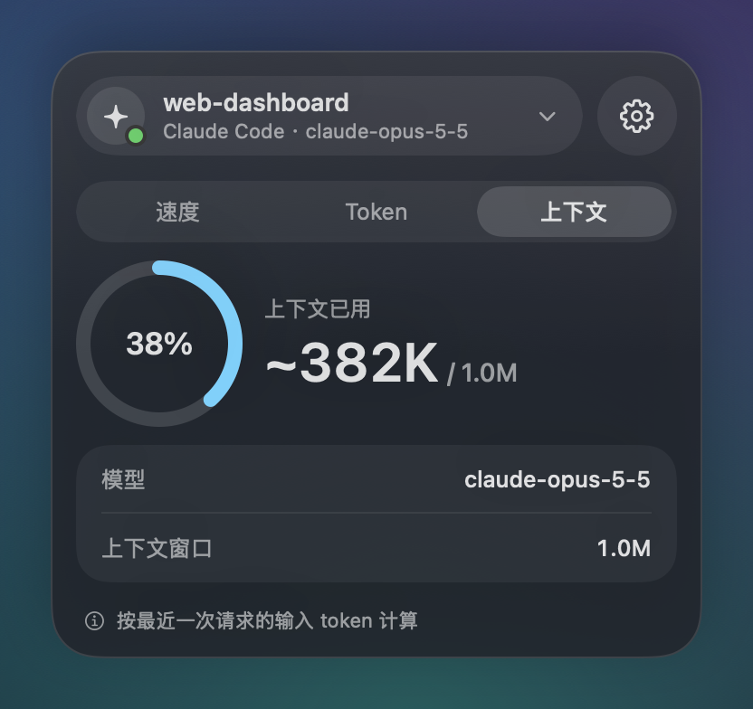
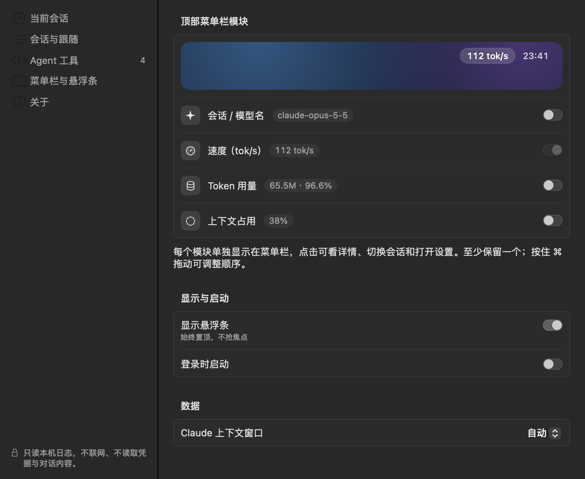
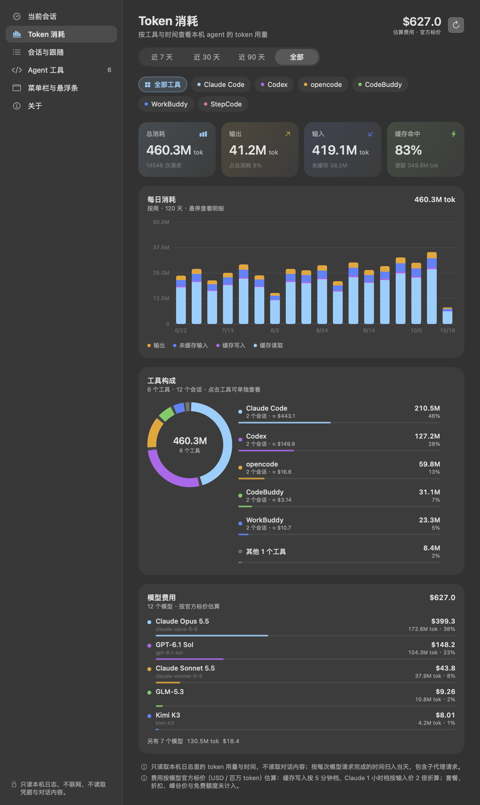

# AgentPulse · Agent 速度表

**给你电脑上的 agent 工具加上实时的 tok/s 速度表。** 这是一个 macOS 菜单栏小工具，启动时自动扫描本机装了哪些 agent 工具（桌面端和 CLI），实时显示它们当前对话的模型输出速度、TTFT、token 用量、缓存命中率和上下文占用。同时开着多个 agent 也能逐个切换查看，历史会话按工具分组浏览；设置窗口里的“Token 消耗”页还可以按工具和时间汇总历史用量。

样式参考 DeepSeek harness 底部的状态栏。它只读取本机日志：不联网，不碰账号，不改任何配置。

[](https://github.com/Flowershangfromthebranches/agent-speedometer/releases/latest)




| 菜单栏详情页 | 切换会话 |
|---|---|
|  |  |
|  |  |

<details>
<summary>设置窗口</summary>



</details>

> 截图中的会话和数据都是演示数据，由 `AgentPulse --render <目录> --demo` 生成。

数据有两种看法，设置在单独的窗口里：

- **悬浮条**：始终置顶，不会抢走焦点。点击某一段就在旁边弹出详情卡。
- **顶部菜单栏模块**：每个模块单独作为一个菜单栏项，想放哪些自己选。点击打开详情页，详情页里可以直接切换会话，也能用 ⚙︎ 打开设置。
- **设置窗口**：独立的窗口，不挂在菜单栏上。打开方式：任意详情页右上角的 ⚙︎、悬浮条右键 →“打开设置…”，或者在 Finder / 启动台里再次打开 AgentPulse。

## 支持的工具

AgentPulse 启动时会扫描一遍本机：`/Applications`、`~/Applications` 里的应用，常见 CLI 安装目录（Homebrew、npm/nvm/fnm、bun、cargo 等），以及各工具的数据目录。扫描只判断这些路径是否存在，不运行任何 agent 工具。之后哪个工具有了新会话，就会自动出现在会话列表里。设置窗口和“更多会话”窗口里都可以手动重新扫描。

能读取速度的工具：

| 工具 | 本地日志位置 | 说明 |
|---|---|---|
| Claude Code（命令行版 / Claude 桌面版的 Code 标签页） | `~/.claude/projects` | 日志不记录首 token 时间，速度里含首 token 等待，略偏低 |
| Codex（命令行版 / 桌面版） | `~/.codex/sessions`、`~/.codex/archived_sessions` | 有首个输出时间，能显示真实 TTFT；旧会话压成 `.jsonl.zst`，统计用量时会调用本机 `zstd` 解压 |
| DeepSeek Harness | `~/.dsh/storages/session_projcache/sessions` | 直接用它自己统计好的解码时间和 token 数，和它的状态栏一致 |
| opencode | `~/.local/share/opencode/opencode.db` | 只读方式打开 SQLite，只查会话表和消息表 |
| MiMo Code | `~/.local/share/mimocode/mimocode.db` | 同 opencode |
| CodeBuddy | `~/.codebuddy/projects`、`~/.codebuddycn/projects` | |
| WorkBuddy（国内版） | `~/.workbuddy/projects` | |
| WorkBuddy AI（国际版） | `~/.workbuddy-ai/projects` | 和国内版是不同的 App，数据目录也分开，会话分开列 |
| StepCode | `~/.stepcode/agent/sessions` | |
| pi | `~/.pi/agent/sessions` | |
| ZCode | `~/.zcode/cli/rollout` | 生成标题等辅助调用不计入 |
| Antigravity | `~/.gemini/antigravity*/brain` | 日志只有每步开始时间，**只能显示 token，不能算速度** |
| Grok CLI | `~/.grok/sessions`、`~/.grok/archived_sessions` | 日志按每轮汇总记录用量，**只能显示 token，不能算速度** |
| Qoder / Qoder CN | `~/.qoder/projects` / `~/.qoder-cn/projects`，兼容 `~/.qoderwork/projects` / `~/.qoderworkcn/projects` | 两个版本分开统计实际 Credits 和请求结束后的 **Credits/s**，并显示日志报告的上下文占比 |

能检测到、但暂时读不了速度的工具，会在“更多会话”窗口里列出并注明原因：

- **本地日志不记录 token 用量**：Kimi、Command Code。
- **本机没有会话样本，暂未适配**：Gemini CLI、Qwen Code、iFlow CLI。
- **没有在本机找到可读的会话记录**：Cursor、Trae、Kiro、Windsurf、GitHub Copilot CLI、Factory Droid、Crush、Goose、Devin、MiniMax Code、Aider、Cline、OpenHands。这些工具的会话一般存在云端或加密存储里。

另外 Claude 桌面版的普通聊天（Code 标签页之外的对话）也不支持，因为它不在本地写日志。原因见下文“合规与安全”。

## 安装与使用

### macOS

1. 到 [Releases](https://github.com/Flowershangfromthebranches/agent-speedometer/releases/latest) 下载 `AgentPulse-<版本>.dmg`。
2. 打开 dmg，把 AgentPulse 拖进“应用程序”。
3. 第一次打开时，在“应用程序”里**右键 AgentPulse → 打开**，再点一次“打开”。

第 3 步是因为应用只做了 ad-hoc 签名，没有 Apple 开发者证书公证，直接双击会被 macOS 拦下。如果右键打开也不行，可以到“系统设置 → 隐私与安全性”里点“仍要打开”。

不放心预编译版本的话，也可以按下文“从源码构建”自己编译。

### Windows

1. 到 [Releases](https://github.com/Flowershangfromthebranches/agent-speedometer/releases/latest) 下载 `AgentPulse-Setup-<版本>.exe`。
2. 双击安装（装在当前用户目录，不需要管理员权限），可选创建桌面快捷方式和开机自启。
3. 安装包未做代码签名，首次运行如果出现 SmartScreen 提示，点“更多信息 → 仍要运行”。

也可以从源码运行，详见 [Windows 版本使用说明](windows/README.md)：

- **免安装双击运行**：双击运行 `windows/run.bat` 或 `windows/agentpulse.pyw` 即可弹出置顶桌面悬浮条并自动启动本地设置与 Token 消耗看板。
- **命令行使用**：运行 `python windows/agentpulse.py --tools` 查看已适配工具，或使用 `python windows/agentpulse.py --watch` 查看终端实时速度表。
- **打包独立 EXE**：运行 `windows/build.bat` 可使用 PyInstaller 打包生成独立 `windows/dist/AgentPulse/AgentPulse.exe`。

## 使用

### 悬浮条

| 位置 | 操作 |
|---|---|
| 左侧模型名 | **点击**：弹出会话列表并切换会话<br>**拖动**：移动悬浮条位置（位置会被记住） |
| 速度段 / Token 段 / 上下文段 | 点击打开详情卡，再点一次或点外面关闭 |
| 任意位置右键 | 打开设置 / 隐藏悬浮条 |

悬浮条的尺寸是固定的，鼠标靠近、移动都不会让它变化。

### 切换会话

会话列表**只显示运行中的会话**，也就是最近 10 分钟内有写入、或者正在等模型回复的会话。所有运行中的会话都在后台同时解析，速度实时更新。

- 每一行显示工具图标、项目名、模型、实时 tok/s 和上下文进度条。正在生成的会话图标右下角有绿点，后面显示已经生成了多久。
- 点某一行就固定查看它，会话名旁边会出现图钉。
- 打开“自动跟随最新会话”开关回到自动模式，这时显示最近有写入的那个会话；“跟随范围”可以把自动跟随限定在某一个工具。
- 会话列表在三个地方都有：悬浮条左侧的模型名、任意菜单栏模块详情页顶部的会话名（点一下展开）、设置窗口。

Codex 的自动审查（`codex-auto-review`）会另开一个子代理会话。它不会出现在运行中列表里，也不会被自动跟随，所以不会和主会话来回切换。

### 更多会话

会话列表底部的“更多会话…”会打开一个独立窗口，分三栏：

1. **工具**：检测到的所有 agent 工具，标明是桌面端、CLI 还是只有本地数据。读不了的工具单独分组，并写明原因。
2. **会话**：所选工具的全部会话，按日期分组。子代理会话会标上“子代理”。
3. **详情**：所选会话的速度、token、上下文统计。点“在悬浮条和菜单栏中查看”就固定到这个会话。

历史会话是点开时才解析的，平时不占资源。

“每步输出速度”图显示最近 40 个有效步骤。鼠标移到图上会高亮最近的数据点，并显示该步在会话中的步号、输出速度、输出 token、生成耗时和完成时间；移出后提示消失。悬浮条和菜单栏详情里的小图也支持悬停查看。

Qoder / Qoder CN 的图显示 **Credits 消耗速度**，提示中显示实际 Credits、请求耗时和 Credits/s。按请求 id 去重，`billable: false` 记为 0，计费字段缺失时显示数据缺失；不把 `original_credits` 再加进消耗。最近 5 步与会话平均都按「对应实际 Credits 总和 ÷ 对应请求耗时总和」计算，包含请求等待，排除能识别的工具执行间隔。缺少起止时间的请求仍计入用量，但不参与速度计算。Credits 在请求完成后结算，因此不是逐 token 的实时输出速度。用量统计页按版本、模型和时间展示 Credits，两个版本的单位不互相换算，也不与 token 或美元费用相加。目前未找到适用于这些记录、可验证的 Credits → token 换算规则，因此不提供伪造的 token 估计值；计量依据见 [Qoder Credits 说明](docs/qoder-credits.md)。

### Token 消耗

设置窗口左侧的 **Token 消耗** 页把本机所有支持的工具的日志汇总成 token 用量：可以切换近 7 / 30 / 90 天或全部时间，也可以点某个工具只看它。图表按天堆叠输出、未缓存输入、缓存读取和缓存写入（时间跨度长时自动按周或按月），鼠标悬停能看到当天的明细。下方的环形图在“全部工具”时显示各工具的占比，选中某个工具后则显示它的 token 构成。

页面顶部会按模型官方标价估算费用，下方的“模型费用”卡按模型列出 token 和估算费用。价格表参考 [CC-Switch](https://github.com/farion1231/cc-switch) 的内置价目和各家官网标价（USD / 百万 token）；缓存写入按 5 分钟档计算，Claude 1 小时档按输入价 2 倍折算。套餐、折扣、峰谷价和免费额度不计入，未匹配到价格的模型只显示 token 并标注“价格未知”。

统计只读取日志里的时间戳和 token 数字，按每次模型请求完成的时间归入当天；子代理请求也计入。Claude Code 会按 `message.id` 跨文件去重：恢复或分叉会话时复制的历史只算一次（与 CC-Switch 的规则一致，优先保留带 `stop_reason` 的完整记录）。Codex 会同时扫描 `sessions` 和 `archived_sessions`（含 `.jsonl.zst` 压缩归档），并按 fork 血缘去掉重放的历史；读取压缩日志需要本机装有 `zstd`（`brew install zstd`），没有时只统计未压缩会话并在页面上提示。Grok CLI 按每轮的 `turn_completed` 汇总计入。DeepSeek Harness 的日志只保存会话累计值，会整段计入最后更新当天。第一次统计会读取历史日志，之后会按文件缓存，没有变化的日志不会重复解析。



### 顶部菜单栏模块

在设置窗口的“顶部菜单栏模块”里，可以单独开关这四个模块：

| 模块 | 菜单栏显示 | 点击后 |
|---|---|---|
| 会话 / 模型名 | `✦ claude-opus-5-5`（固定会话时图标换成图钉） | 会话列表，可以切换 |
| 速度 | `110 tok/s`（只有文字，不带图标） | 会话统计：模型用时、工具用时、TTFT、各种速度 |
| Token 用量 | `▤ 4.3M · 97.3%` | Token 明细：未缓存输入、缓存读写、输出；Codex 还会显示额度窗口 |
| 上下文占用 | `◔ 78%` | 上下文进度条、模型和窗口大小 |

默认只开“速度”。模块至少要保留一个，因为详情页和设置要从模块进入。按住 ⌘ 拖动可以调整这些模块在菜单栏里的顺序。

每个模块的详情页顶部是当前会话按钮，点一下就能展开会话列表直接切换；右边的齿轮按钮用来打开设置窗口。下面的“速度 / Token / 上下文”切换栏可以在三种详情之间切换，所以只开一个模块也能看到全部数据。

> 带刘海的 MacBook 上，如果菜单栏图标太多，macOS 会把放不下的图标藏到刘海后面。开了模块却看不到时，可以退出几个不常用的菜单栏应用，或者按住 ⌘ 把模块拖到靠右的位置。

## 指标说明

- **轮**：你发出的消息数。**步**：模型请求次数（每次工具调用后模型会再被调用一次）。
- **输出速度** = 输出 token ÷ 生成耗时。如果日志记录了首个输出的时间（Codex），就扣掉首 token 之前的等待。少于 20 个 token 或短于 0.25 秒的步骤不计入，避免噪声。
  - 悬浮条和菜单栏显示的是“近 5 步”的速度。详情里另外还有“最近一步”和“会话平均”。
- **工具调用用时**：从一步结束，到触发下一步的工具结果返回之间的时间。
- **上下文**：最近一次请求的输入 token ÷ 模型的上下文窗口。
  - Codex 的窗口大小来自日志。Claude Code 的日志里没有窗口大小，默认自动估计，也可以在设置里手动选 200K 或 1M。
- **Token 消耗页**：总 token = 输出 + 未缓存输入 + 缓存读取 + 缓存写入；缓存命中率 = 缓存读取 ÷ 输入总量。按每次模型请求完成的时间归入当天，不是按日志写入时间。
- **生成中**：最新事件是用户消息或工具结果、还没等到回复时显示。任务完成、被中断、API 报错都会结束这个状态。

**局限**：日志要等每个内容块写完才会落盘，所以速度是**每一步更新一次**，没法随着打字逐 token 刷新。想要流式级别的速度，就得去截获网络流量，这个项目刻意不这么做，原因见下文。

## 合规与安全

设计原则：**完全不碰 agent 工具本身和它们的服务**，只读取这些工具自己已经写在你本机上的日志。

会做的事：

- 以**只读**方式读取上文表格里列出的日志目录。SQLite 数据库用只读模式打开，只查会话表和消息表，不碰账号或凭据相关的表。
- 扫描已安装的工具时，只检查应用、可执行文件、数据目录是否存在，不运行它们，也不读它们的配置。
- 统计 Codex 的压缩归档时，会调用本机的 `zstd` 进程对 `.jsonl.zst` 做只读解压；不会运行任何 agent 工具，也不联网。
- 只取时间戳、token 用量、模型名、工作目录、会话标题、上下文窗口这些元数据。
- 消息正文、工具输入和输出一律不保存、不显示、不上传。这些日志里有你完整的对话，包括你粘贴进去的密钥。

不会做的事（源码里没有 `URLSession`、网络、钥匙串或写文件相关的调用）：

- 不联网，不调用任何 API，包括未公开的用量和额度接口。
- 不读 `~/.codex/auth.json` 等任何工具的凭据文件、钥匙串或 OAuth token，也从不以你的身份认证。
- 不搭本地代理、不做中间人截获，不改 agent 工具的 `base_url` 等任何配置。
- 不向 Electron 或桌面应用注入代码、不修改它们，也不借助辅助功能或屏幕录制去读界面。
- 不向模型发请求，所以不消耗你的额度。
- 不需要辅助功能、屏幕录制等任何系统权限。

所以 AgentPulse 只是一个被动的本地日志查看器，对这些服务来说它根本不存在。

注意：以上是工程层面的判断，不构成法律意见。将来某个工具改了日志格式或位置，只需要更新解析器，不会转而采用上面列出的任何方式。

## 从源码构建

需要 macOS 13 以上，以及 Xcode（或 SwiftPM 能正常用的 Command Line Tools）。

```bash
scripts/build-app.sh            # 生成 dist/AgentPulse.app 和 dist/AgentPulse-<版本>.dmg
scripts/build-app.sh --install  # 另外安装到 /Applications
```

调试命令（不启动界面）：

```bash
.build/release/AgentPulse --tools                # 列出检测到的 agent 工具和会话数
.build/release/AgentPulse --dump-tool codex 3    # 输出某个工具最近 3 个会话的统计
.build/release/AgentPulse --dump                 # 输出最近会话的统计
.build/release/AgentPulse --dump <session.jsonl> # 指定某个日志文件
.build/release/AgentPulse --usage 30             # 输出最近 30 天各工具的 token 用量
.build/release/AgentPulse --usage all            # 统计全部历史日志
.build/release/AgentPulse --usage all --tool qoder-cn # 只统计 Qoder CN（含 Credits）
bash scripts/test-qoder.sh                      # Qoder 计量与速度核心检查
.build/release/AgentPulse --render ./preview          # 用你的真实会话把界面渲染成 PNG
.build/release/AgentPulse --render ./preview --demo   # 用演示数据渲染（README 截图就是这样生成的）
```

### 代码结构

| 文件 | 作用 |
|---|---|
| `Sources/AgentPulse/Tools.swift` | agent 工具清单和安装检测 |
| `Sources/AgentPulse/Readers.swift` | 各工具的会话发现，JSON / SQLite 读取 |
| `Sources/AgentPulse/Parsers.swift` | Claude Code / Codex 日志解析，增量读取文件尾部 |
| `Sources/AgentPulse/MoreParsers.swift` | CodeBuddy、StepCode、ZCode、Antigravity 等工具的日志解析 |
| `Sources/AgentPulse/Model.swift` | 每一步的记录和各项统计的计算 |
| `Sources/AgentPulse/TokenUsage.swift` | Token 用量的扫描、跨文件去重、缓存和按天聚合 |
| `Sources/AgentPulse/ModelPricing.swift` | 模型单价表、模型名归一化和费用估算 |
| `Sources/AgentPulse/UsagePage.swift` | 设置窗口的 Token 消耗页、图表和模型费用卡 |
| `Sources/AgentPulse/Monitor.swift` | 运行中会话的跟踪和自动跟随 |
| `Sources/AgentPulse/SessionBrowser.swift` | “更多会话”窗口 |
| `Sources/AgentPulse/HUD.swift` | 悬浮条和详情卡窗口 |
| `Sources/AgentPulse/MenuBarModules.swift` | 顶部菜单栏的各个独立模块 |
| `Sources/AgentPulse/DesignKit.swift` | 液态玻璃表面、速度走势线、统计卡片等共用界面组件 |
| `Sources/AgentPulse/Views.swift` | 状态条、详情卡、会话列表等界面 |
| `Sources/AgentPulse/App.swift` | 应用入口和独立的设置窗口 |
| `scripts/build-app.sh` / `scripts/make-icon.swift` | 打包脚本和图标生成 |

### 接入新工具

在 `Tools.swift` 的 `ToolRegistry` 里加一条工具描述（应用名、CLI 名、数据目录）。如果它的日志是 JSONL，就参照 `MoreParsers.swift` 写一个 `SessionParser`；如果是其他格式，就在 `Readers.swift` 里写一个 `SessionReader`。前提是这个工具自己会把带 token 用量的日志写在本地。

## 许可证

[Apache License 2.0](LICENSE)

本项目与 Anthropic、OpenAI、DeepSeek 没有关联。Claude、Codex 等名称归各自所有者所有，这里只用来说明本工具兼容哪些软件。
